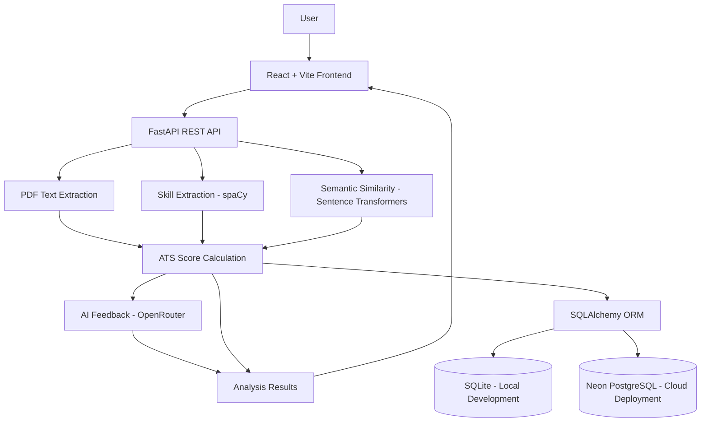

# ResumeIQ — System Architecture

This diagram shows how ResumeIQ processes a resume and stores its analysis results.

## Main Components

- **Frontend:** React and Vite provide the user interface.
- **Backend:** FastAPI handles requests and coordinates resume analysis.
- **PDF processing:** Extracts text from uploaded PDF resumes.
- **NLP:** spaCy extracts skills from resumes and job descriptions.
- **Semantic similarity:** Sentence Transformers compares resume and job-description meaning.
- **Scoring:** Combines skill matching and semantic similarity.
- **AI feedback:** OpenRouter provides recommendations through an LLM.
- **Database:** SQLAlchemy connects the application to SQLite locally and Neon PostgreSQL in deployment.
