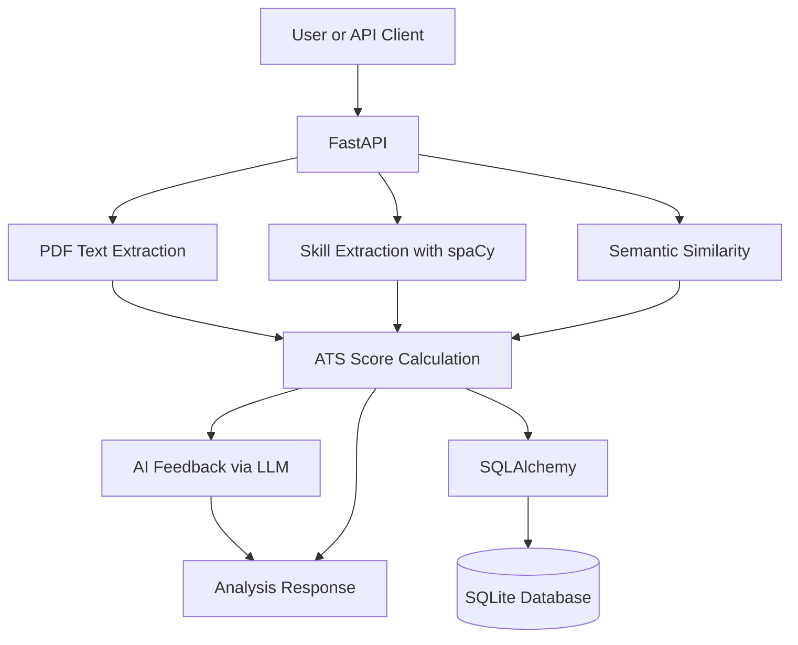

# AI Resume ATS Analyzer

An AI-powered resume analysis API that evaluates how well a resume matches a job description using skill matching, semantic similarity, and AI-generated feedback.

## Features

- **ATS-style scoring** using skill matching and semantic similarity.
- **PDF resume processing** to extract text from uploaded resumes.
- **NLP skill extraction** using spaCy.
- **Semantic similarity** using Sentence Transformers.
- **AI-generated feedback** using an LLM API.
- **Analysis history** with database operations.
- **REST API** built with FastAPI.
- **Automated testing** using pytest.

## Technology Stack

- Python
- FastAPI and Uvicorn
- spaCy
- Sentence Transformers
- Pydantic
- pypdf
- SQLAlchemy and SQLite
- OpenRouter API
- pytest

## How ATS Scoring Works

The current scoring approach combines two scores:

- **Skill Match Score (60%)** — how many required job skills appear in the resume.
- **Semantic Score (40%)** — how closely the resume's meaning matches the job description.

**Formula:**

`ATS Score = (Skill Match Score × 0.60) + (Semantic Score × 0.40)`

This is a learning-project score, not an official score from a commercial Applicant Tracking System.

## Project Structure

```text
AI-Resume-ATS-Analyzer/
├── app/
│   ├── create_tables.py
│   ├── database.py
│   ├── embedding.py
│   ├── llm.py
│   ├── main.py
│   ├── models.py
│   ├── pdf_parser.py
│   └── skill_extractor.py
├── tests/
│   ├── test_main.py
│   └── test_scoring.py
├── .gitignore
├── requirements.txt
└── README.md
```

## Getting Started

### 1. Clone the repository

```bash
git clone https://github.com/Zulkharnain313/AI-Resume-ATS-Analyzer.git
cd AI-Resume-ATS-Analyzer
```

### 2. Create a virtual environment

```powershell
python -m venv venv
.\venv\Scripts\Activate.ps1
```

### 3. Install dependencies

```bash
python -m pip install --upgrade pip
pip install -r requirements.txt
```

### 4. Configure your API key

Create a `.env` file in the project root and add your own key:

```dotenv
OPENROUTER_API_KEY=your_api_key_here
```

Replace the placeholder with your own API key. **Never upload your real `.env` file or API key to GitHub.**

### 5. Run the API

```bash
uvicorn app.main:app --reload
```

Open the following URLs:

- API root: http://127.0.0.1:8000/
- Health check: http://127.0.0.1:8000/health
- Swagger API documentation: http://127.0.0.1:8000/docs

## API Endpoints

| Method | Endpoint | Purpose |
|---|---|---|
| GET | `/` | Check the API welcome response |
| GET | `/health` | Check API health |
| POST | `/analyze` | Analyze resume text |
| POST | `/upload-resume` | Upload a resume PDF |
| POST | `/analyze-pdf` | Analyze an uploaded PDF |
| GET | `/analyses` | List saved analyses |
| GET | `/analyses/{analysis_id}` | Retrieve one analysis |
| PUT | `/analyses/{analysis_id}` | Update an analysis |
| DELETE | `/analyses/{analysis_id}` | Delete an analysis |

Use `/docs` to inspect request fields and test the endpoints.

## Architecture



## Run Tests

Activate your virtual environment and run:

```bash
python -m pytest -v
```

## Future Improvements

- Build a dashboard to visualize ATS scores and analysis history.
- Improve skill extraction and scoring accuracy.
- Add authentication and authorization.
- Deploy the API online.
- Add Docker containerization.

## Security

- Keep `.env` out of version control.
- Never hardcode API keys in Python files.
- If a key is accidentally uploaded, revoke it and create a replacement.
- Do not upload private resumes or real user data to a public repository.

## Author

Developed as a portfolio project to explore NLP, semantic embeddings, and AI-powered resume analysis.
