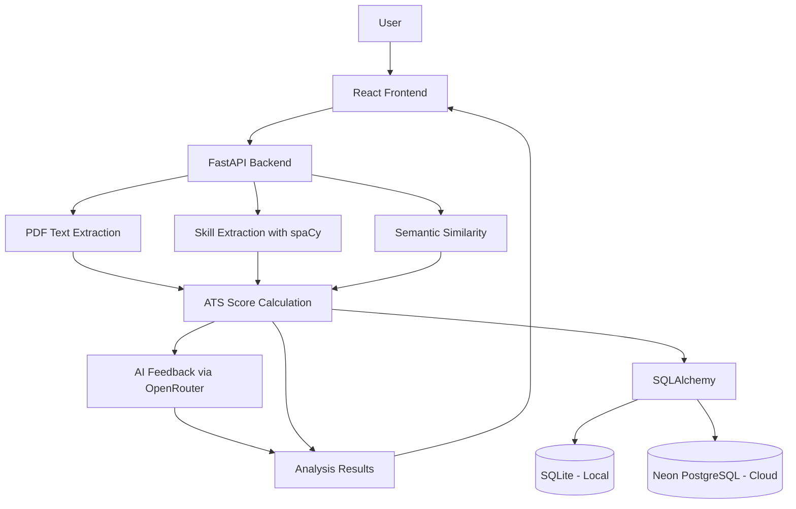

# ResumeIQ — AI Resume ATS Analyzer

ResumeIQ is an AI-powered resume analysis application that evaluates how well a resume matches a job description using skill matching, semantic similarity, and AI-generated feedback. It provides ATS-style scoring, identifies matched and missing skills, and helps users understand how to improve their resumes for specific roles.

## Features

- **ATS-style scoring** using skill matching and semantic similarity.
- **PDF resume processing** to extract text from uploaded resumes.
- **NLP skill extraction** using spaCy.
- **Semantic similarity** using Sentence Transformers.
- **AI-generated feedback** using an LLM API through OpenRouter.
- **Analysis history** with database-backed CRUD operations.
- **REST API** built with FastAPI.
- **React frontend** for interacting with resume analysis features.
- **Automated testing** using pytest.
- **Cloud deployment** using Render and Neon PostgreSQL.

## Technology Stack

| Category | Technologies |
|---|---|
| Language | Python |
| Backend | FastAPI, Uvicorn |
| Frontend | React, Vite |
| NLP | spaCy |
| Semantic similarity | Sentence Transformers |
| PDF processing | pypdf |
| Database | SQLite locally, Neon PostgreSQL in deployment |
| ORM | SQLAlchemy |
| LLM integration | OpenRouter API |
| Testing | pytest |
| Deployment | Render |

## How ATS Scoring Works

ResumeIQ combines skill matching and semantic similarity to calculate an ATS-style score.

- **Skill Match Score (60%)** — measures how well the resume's extracted skills match the required job skills.
- **Semantic Score (40%)** — measures semantic similarity between the resume and the job description.

**Formula:**

`ATS Score = (Skill Match Score × 0.60) + (Semantic Score × 0.40)`

This is a learning-project scoring method, not an official score from a commercial Applicant Tracking System. Results depend on the resume, job description, and extraction and scoring methods.

## Architecture



## Project Structure

```text
AI-Resume-ATS-Analyzer/
├── app/
│   ├── create_tables.py
│   ├── database.py
│   ├── embedding.py
│   ├── llm.py
│   ├── main.py
│   ├── models.py
│   ├── pdf_parser.py
│   └── skill_extractor.py
├── tests/
│   ├── test_main.py
│   └── test_scoring.py
├── frontend/
├── .gitignore
├── requirements.txt
└── README.md
```

The frontend directory may contain additional files and folders. The structure above is a simplified overview.

## Getting Started

### 1. Clone the repository

```bash
git clone https://github.com/Zulkharnain313/AI-Resume-ATS-Analyzer.git
cd AI-Resume-ATS-Analyzer
```

### 2. Create and activate a virtual environment

On Windows PowerShell:

```powershell
python -m venv venv
.\venv\Scripts\Activate.ps1
```

### 3. Install backend dependencies

```bash
python -m pip install --upgrade pip
pip install -r requirements.txt
```

### 4. Configure environment variables

Create a `.env` file in the project root:

```dotenv
OPENROUTER_API_KEY=your_api_key_here
```

Replace the placeholder with your own OpenRouter API key. Do not share or commit your actual API key.

The application uses SQLite by default for local development. To use a PostgreSQL database locally, configure `DATABASE_URL` with your own PostgreSQL connection string.

### 5. Run the backend

```bash
uvicorn app.main:app --reload
```

Open these URLs in your browser:

- API root: http://127.0.0.1:8000/
- Health check: http://127.0.0.1:8000/health
- Interactive API documentation: http://127.0.0.1:8000/docs

### 6. Run the frontend

Open a second terminal:

```powershell
cd frontend
npm install
npm run dev
```

Open the local URL displayed by Vite in your terminal, usually http://localhost:5173/.

Make sure the frontend is configured to call the correct backend URL for your local or deployed environment.

## API Endpoints

| Method | Endpoint | Purpose |
|---|---|---|
| GET | `/` | Check the API welcome response |
| GET | `/health` | Check API health |
| POST | `/analyze` | Analyze resume text |
| POST | `/upload-resume` | Upload a resume PDF |
| POST | `/analyze-pdf` | Analyze an uploaded PDF |
| GET | `/analyses` | List saved analyses |
| GET | `/analyses/{analysis_id}` | Retrieve one analysis |
| PUT | `/analyses/{analysis_id}` | Update an analysis |
| DELETE | `/analyses/{analysis_id}` | Delete an analysis |

Use `/docs` to inspect request fields and test endpoints.

## Database Configuration

ResumeIQ supports different database configurations for development and deployment:

- **Local development:** SQLite using `resume_analyzer.db`.
- **Cloud deployment:** Neon PostgreSQL configured through the `DATABASE_URL` environment variable on Render.

The database configuration selects the appropriate database based on the environment. Existing SQLite records are not automatically migrated to PostgreSQL.

## Running Tests

Activate your virtual environment and run:

```bash
python -m pytest -v
```

The tests check selected API and scoring behavior. Run them after making code changes to catch regressions.

## Deployment

The backend is deployed on Render, and its PostgreSQL database is hosted on Neon.

- **Live API:** https://ai-resume-ats-analyzer-xan2.onrender.com/
- **API documentation:** https://ai-resume-ats-analyzer-xan2.onrender.com/docs
- **Health check:** https://ai-resume-ats-analyzer-xan2.onrender.com/health

The frontend should be configured with the deployed backend URL when used in production. If the frontend is deployed separately, its public URL can be added here.

## Future Improvements

- Improve skill extraction and scoring accuracy.
- Add authentication and authorization.
- Add more automated tests, including database operation tests.
- Improve dashboard visualizations and analysis history.
- Add Docker containerization.
- Enhance deployment configuration and monitoring.

## Security

- Keep `.env` out of version control.
- Never hardcode API keys in Python files.
- Store production secrets in Render environment variables.
- If an API key is accidentally exposed, revoke it and create a replacement.
- Do not upload private resumes or real user data to a public repository.

## Author

Developed as a portfolio project to explore NLP, semantic embeddings, REST API development, database integration, and AI-powered resume analysis.
